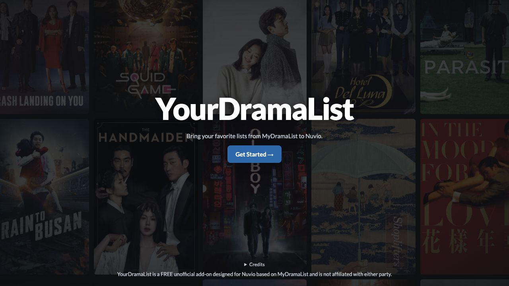

# YourDramaList (YDL)

**v1.0.5** · MyDramaList brought to Nuvio.
A FREE and unofficial add-on for Asian dramas and movies using MDL database.

**[ENTER THE MAIN SITE HERE](https://yourdramalist.val.run/)** · [Privacy](PRIVACY.md) · [Self-hosting](DEPLOYMENT.md)

## Features

- Site is best viewed in Desktop but is also designed for Mobile users as well.

- Import MyDramaList catalogs via username or profile link.

- Search dramas, actors, and directors to view synopses, bios, ratings, and related lists.

- Save any actor or director's complete filmography as a catalog.

- Discover new titles with weekly curated lists.

- Filter the most popular and top-rated shows and movies by country.

- View MyDramaList ratings, user reviews, and overall consensus directly in Nuvio (have to press the play button first on a title to access, manual play must be selected to view this feature)

- Enable optional badges for catalog posters from IMDb, Rotten Tomatoes, and Letterboxd (requires TMDB and MDBList APIs).

## Set up

1. Enter your MDL username, or continue without an account.
2. Choose and discover new lists, edit your display preferences for Nuvio.
3. Copy your generated **Manifest URL** into Nuvio.

TMDB and MDBList keys are **optional**, needed only for poster ratings. No MDL password is requested.

## Privacy

API keys are encrypted into your install URL and used with ERDB. Read the [privacy details](PRIVACY.md).

## Project

[Testing](TESTING.md) · [Changelog](CHANGELOG.md) · [Report a bug](https://github.com/palmajay-coder/yourdramalist/issues) · [Security](SECURITY.md) · [MIT license](LICENSE)

The current app is in the repository root. The original version is preserved in [legacy/](legacy/) with [historical documentation](docs/LEGACY_README.md).

Created and maintained by [Jay](https://github.com/palmajay-coder), with development assistance from **OpenAI Codex**.

Not affiliated with MyDramaList, Nuvio or the data providers. [Third-party content](THIRD_PARTY_NOTICES.md) is excluded from the software license.
