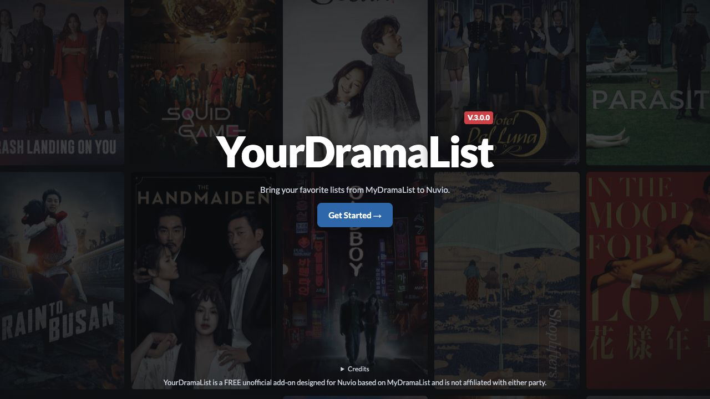

# YourDramaList V3 — public beta

A free MyDramaList catalog add-on for Nuvio.

**[Open V3](https://niwa710--b3275342d95911f1bbef1607ee4eb77e.web.val.run/)** · [Privacy](PRIVACY.md) · [Self-hosting](DEPLOYMENT.md) · [MIT license](LICENSE)

## Set up

1. Choose **Get Started**, then enter your MDL username or skip.
2. Select public lists, filmographies or country catalogs.
3. Set your preferences. TMDB and MDBList keys are optional for poster ratings.
4. Copy the generated **Manifest URL** into Nuvio, or use **Install in Nuvio** on a compatible device.

No MDL password is requested. Poster-rating keys are encrypted into your install URL and used with ERDB. Keep your link private; see [Privacy](PRIVACY.md).

## Features

- Drama search with original MDL synopsis excerpts, ratings and popularity.
- Public profiles, direct list links and shared selections.
- Actor/director filmographies, newest first.
- Country catalogs for shows and movies.
- MDL reviews, viewer verdicts and optional poster-rating badges.
- Light/dark themes, a poster-wall background and owner-only wallpaper settings.

## Beta notes

Nuvio playback and live ERDB output remain unverified. Some titles may be omitted by matching or missing posters; MDL access restrictions can interrupt results. See the full [beta notes](BETA_NOTES.md).

## Development

Hosted on Val Town. Start with [deployment instructions](DEPLOYMENT.md), [tests](TESTING.md) and the [changelog](CHANGELOG.md). Edit page wording in `text.ts`; `app.ts` is the HTTP entry point.

[Report bugs](https://github.com/palmajay-coder/yourdramalist/issues) without keys or private URLs. Use the [security policy](../SECURITY.md) for sensitive reports. Discuss substantial contributions first.

Created and maintained by [Jay](https://github.com/palmajay-coder), with development assistance from **OpenAI Codex**.

Not affiliated with MyDramaList, Nuvio or the data providers. See [third-party notices](THIRD_PARTY_NOTICES.md).
